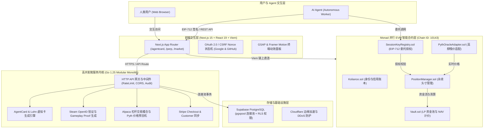

# Koliance — Monad On-Chain Trust & Intelligent Finance Infrastructure

> **项目远景 (Vision)**：**让 AI 不仅能行动，还值得被信任。**  
> *(Make AI not only able to act, but also worthy of trust.)*

Koliance 是构建在 **Monad 高并发并行 EVM**（Chain ID: `10143`）上的去中心化数字身份、游戏信用凭据与智能金融基础设施。

在自主智能体（Autonomous Agents）爆发的时代，AI 已经具备了惊人的决策与行动能力，但普遍缺乏密码学身份、经济信用与可验证的委托边界。Koliance 为 AI Agent 打造从**链上身份证明（DID & Proofs）**、**受控资金授信（AgentCard Visa 虚拟卡）**、**细粒度会话权限（EIP-712 SessionKeyRegistry）** 到 **链上可验证金融清算（Perp Solvency & Vault）** 的全栈可信基础设施，确保每一次 Agent 委托行动均受控、可验、值得信赖。

---

## 🌟 核心理念与三大业务支柱

```
                                  ┌──────────────────────────┐
                                  │      AI Agent 智能体     │
                                  └─────────────┬────────────┘
                                                │
                 ┌──────────────────────────────┼──────────────────────────────┐
                 ▼                              ▼                              ▼
    【1. 信任与数字身份 (DID)】     【2. 资金授信与支付 (AgentCard)】   【3. 智能金融与永续 (Perp)】
    · Steam 游戏时长/成就存证       · ISO 7812 / Luhn 16位虚拟卡       · 链上多空高杠杆永续合约
    · GitHub 开源贡献背书           · EIP-712 Session Key 细粒度授权   · 逐块资金费率与实时清算
    · Keccak256 密码学链上打标      · 单笔/日限额/MCC白名单控制        · 净资产 NAV 计价与池溶性防护
```

### 1. AgentCard：Visa 体系 + 细粒度 Session Key 委托
- **标准卡要素生成**：符合国际 **ISO/IEC 7812** 规范，生成以 `492810` 为 BIN 码的 16 位卡号，通过 **Luhn (MOD 10)** 校验，配备真实 CVV 与有效期。
- **Session Key 权限矩阵**：
  - `MaxPerTxUSD`：单笔最高限额（超限触发 Visa 57 错误码拒付）；
  - `DailyLimitUSD`：每日消费累计上限，支持滚动窗口自动重置；
  - `AllowedMCCs`：限定商户分类码（例如 `7999` 游戏娱乐、`5814` 餐饮快餐、`5734` 软件服务）；
  - `ExpiresAt`：会话生命周期与紧急熔断保护（用户与管理员均可单向冻结）。
- **零延迟链下微支付**：内存/数据库事务高频扣款，支持万级 TPS；累计交易通过 `POST /api/v1/agentcard/batch-settle` 批量哈希归集上链至 Monad。

### 2. Proof of Identity：Steam 与 GitHub 双轨信用背书
- **Steam 游戏信用**：秒级抓取玩家全部公开游戏库、游玩总时长与特定游戏成就；生成标准化凭证摘要，经 Keccak256 签名打包成 `ProofHash` 写入 `Koliance.sol`，直接激活 AgentCard 信用额度。
- **GitHub 开源背书**：基于 OAuth 2.0 提取开发者全量公开仓库、Star 贡献与主力技术栈（TypeScript, Go, Solidity 等），铸造链上开发者信用凭证（Proof of BUIDL）。

### 3. Perp 永续合约：链上可验证流动性与偿付能力保障
- **原生并行 EVM 撮合**：基于 Monad 极速确认机制，支持美股及加密标的 1x~50x 多空双向交易。
- **偿付能力强约束（Solvency Guards）**：LP 存取款基于扣除未结交易负债后的 NAV 净资产价值计价，杜绝流动性穿仓风险。

---

## 🏛️ 系统架构 (System Architecture)

本项目采用**模块化全栈解耦架构（Modular Monolith + Web3 Native）**：



### 目录结构树

```
koliance/
├── contracts/                     # 【智能合约工程】Hardhat + Viem + Monad EVM Osaka
│   ├── contracts/
│   │   ├── Koliance.sol           # 身份与信用背书链上存证
│   │   ├── KolToken.sol           # 平台激励代币
│   │   └── perp/
│   │       ├── SessionKeyRegistry.sol # EIP-712 会话委托与熔断注册表
│   │       ├── PositionManager.sol    # 永续合约头寸管理与清算
│   │       ├── Vault.sol              # LP 流动性池与净 NAV 结算
│   │       └── PythOracleAdapter.sol  # Pyth 网络实时喂价适配器
│   ├── hardhat.config.ts          # 编译器版本: 0.8.31, EVM: osaka
│   └── package.json
│
├── backend/                       # 【后端微服务工程】Go 1.25 高并发 Modular Monolith
│   ├── cmd/
│   │   ├── api/main.go            # 服务入口与依赖注入
│   │   └── migrate/main.go        # 数据库迁移工具
│   ├── internal/
│   │   ├── httpapi/               # HTTP 路由与安全中间件
│   │   ├── agentcard/             # Visa BIN/Luhn 算法、Session Key 矩阵、微支付
│   │   ├── game/                  # Steam OpenID 握手与链上存证生成
│   │   ├── developer/             # GitHub API 统计与 BUIDL 证明
│   │   ├── market/                # Alpaca 美股撮合与实时行情
│   │   ├── config/                # 环境变量与运行时配置
│   │   └── platform/              # PostgreSQL (pgxpool) 与 Stripe SDK 适配
│   └── go.mod
│
├── src/                           # 【前端交互终端】Next.js 15 + React 19 + Tailwind
│   ├── app/                       # App Router: /, /agentcard, /perp, /market, /api/auth/*
│   ├── components/                # 终端控制台、卡片组件、GSAP 核心光效
│   ├── lib/                       # Web3 API、OAuth 状态机、Supabase 客户端、信用模型
│   └── entities/                  # 数据库业务模型定义
│
├── tests/                         # 全局集成测试与安全单测 (Vitest)
├── e2e/                           # 浏览器端对端自动化测试 (Playwright)
└── README.md                      # 项目主文档
```

---

## 📦 技术栈与所有依赖版本清单 (Dependencies Matrix)

本项目涵盖 **TypeScript / Next.js**、**Solidity**、**Python (Agent SDK)** 与 **Go** 四大多语言协同环境，各环境的依赖版本如下：

### 1. TypeScript & 前端主工程 (`package.json`)
- **运行环境**：Node.js `>=22.13`，包管理器推荐 **pnpm**
- **核心框架**：
  - `next`: `^15.2.0` (Next.js 15 App Router)
  - `react`: `^19.0.0`
  - `react-dom`: `^19.0.0`
- **Web3 与数据交互**：
  - `viem`: `^2.23.0` (高性能轻量级 EVM 交互)
  - `@supabase/supabase-js`: `^2.117.2` (PostgreSQL 客户端与 Realtime)
- **动效与 UI 组件**：
  - `gsap`: `^3.12.7`
  - `@gsap/react`: `^2.1.2`
  - `framer-motion`: `^12.4.7`
  - `lucide-react`: `^0.475.0`
  - `canvas-confetti`: `^1.9.4`
  - `tailwindcss`: `^3.4.17`
  - `tailwind-merge`: `^3.0.1`
  - `clsx`: `^2.1.1`
  - `postcss`: `^8.5.2`
  - `autoprefixer`: `^10.4.20`
- **测试与代码质量**：
  - `typescript`: `^5.7.3`
  - `vitest`: `^4.1.11`
  - `@vitest/coverage-v8`: `^4.1.11`
  - `@vitejs/plugin-react`: `^6.1.2`
  - `@playwright/test`: `^1.64.0` (E2E 端到端测试)
  - `eslint`: `^8.57.0`
  - `eslint-config-next`: `^15.2.0`

### 2. Solidity 智能合约工程 (`contracts/package.json` & `hardhat.config.ts`)
- **Solidity 编译器版本**：`0.8.31`
- **目标 EVM 版本**：`osaka` (Optimizer: 200 runs)
- **编译与部署套件**：
  - `hardhat`: `^3.14.0`
  - `@nomicfoundation/hardhat-ignition`: `^3.1.8`
  - `@nomicfoundation/hardhat-toolbox-viem`: `^5.0.7`
  - `viem`: `^2.55.19`
  - `forge-std`: `github:foundry-rs/forge-std#v1.16.2`
  - `tsx`: `^4.23.15`
  - `dotenv`: `^17.4.2`
  - `typescript`: `~7.0.2`

### 3. Python AI Agent 协同开发推荐套件 (`requirements.txt`)
用于外部开发者与自主 AI Agent 编写自动化脚本、调用 EIP-712 签名与交互：
- **运行环境**：Python `>=3.11`
- **密码学与 Web3 核心**：
  - `web3>=6.15.0` (EVM 链上交互与合约调用)
  - `eth-account>=0.11.0` (EIP-712 TypedData 构造与离线签名)
  - `pycryptodome>=3.20.0` (安全哈希算法支持)
- **网络通信与 Agent 状态**：
  - `httpx>=0.27.0` / `requests>=2.31.0` (异步/同步 HTTP 客户端)
  - `pydantic>=2.6.0` (数据结构类型校验)
  - `fastapi>=0.110.0` (可选，Agent 本地服务化暴露)

### 4. Go 后端微服务内核 (`backend/go.mod`)
- **运行环境**：Go `1.25.0`
- **核心依赖**：
  - `github.com/jackc/pgx/v5`: `v5.11.0` (PostgreSQL 高性能连接池 `puddle/v2`)
  - `github.com/stripe/stripe-go/v78`: `v78.12.0` (Stripe 官方支付网关)
  - `github.com/joho/godotenv`: `v1.5.1` (本地环境变量解析)

---

## 🛡️ 代码规范与开发者 / Agent 协同开发准则

为了保证**人类开发者与 AI Agent 能够高效、安全、无歧义地协同开发与迭代**，项目遵循以下严格规范：

### 1. 密码学与安全规范 (Security First)
- **零明文敏感凭据 (Zero Plaintext Secrets)**：严禁在代码、注释或 Git 历史中提交任何 API 密钥、助记词或 Private Key。必须全部通过 `.env`、平台环境变量或 KMS 动态注入。
- **严格 CSRF 防御与 Origin 校验**：OAuth 2.0（GitHub/Google）流程必须在服务端使用加密安全的随机 Nonce，以 `HttpOnly`、`SameSite=Lax` Cookie 传递，回调时严格比对白名单来源域名，坚决杜绝重放与伪造攻击。
- **行级数据隔离与特权剥离 (RLS & Privilege Stripping)**：数据库关键表（`users`, `cards`, `session_keys`）启用 Row Level Security；普通用户接口提交的个人资料更新中，`trust_tier` 与 `credit_allowance_usd` 等特权字段在服务端必须无条件剥离，仅允许受信任的服务端认证工作流修改。

### 2. 链上/链下双轨一致性 (Parity & Precision)
- **单一真理来源 (Single Source of Truth)**：链上合约判定是唯一不可争议的真相。前端与 Go 后端计算的清算价格、强平线和抵押率必须与链上合约保持零误差对齐（遵循清算平价测试 `liquidation-parity.test.ts`）。
- **杜绝浮点精度丢失**：所有金融金额、抵押品资产、代币数量在逻辑处理与通信中一律使用无损大数（`bigint` / 整数最小单位 Wei / 6 位整数微美分），严禁在金融核心链路上使用 IEEE 754 浮点数运算。

### 3. 架构模块化与可维护性规范 (Architecture & Clean Code)
- **Go 后端分层隔离**：`internal/` 目录严格按业务模块自治（`agentcard`, `game`, `market`, `httpapi`），禁止模块间循环依赖；统一由 `httpapi.Router` 进行依赖注入和路由装配。
- **Next.js 服务端/客户端职责分离**：敏感 API 交互逻辑与签名放在 `app/api/` 服务端路由中；前端组件严格区分 `"use client"` 与 Server Components，防止服务端依赖泄露至浏览器。
- **Solidity 安全编码模式**：智能合约严格执行 Checks-Effects-Interactions (CEI) 模式；所有公开方法标明 NatSpec 注释，关键状态流转必须触发 Event 日志。

### 4. 自动化门禁与 CI/CD 测试规范
任何开发者或 AI Agent 在提交代码前，**必须在本地通过以下全部门禁检查**：

```bash
# 1. 前端与整体集成检查
pnpm type:lint          # 执行 tsc --noEmit 与 next lint
pnpm test               # 执行 vitest 全量单元与集成测试 (9 个测试套件，73 项测试用例)
pnpm build              # 验证 Next.js 生产环境构建

# 2. 智能合约测试
cd contracts
npx hardhat test        # 必须通过全部 202 个 Hardhat 单元与场景测试

# 3. 后端微服务测试
cd backend
go vet ./...            # 代码静态分析
go test -race ./...     # 竞态检测与全量 Go 单元测试
```

---

## 🚀 快速启动指南

### 1. 安装依赖
```bash
# 根目录 (前端与集成测试环境)
pnpm install --frozen-lockfile

# 智能合约工程 (独立 npm 环境)
cd contracts && npm ci && cd ..
```

### 2. 环境变量配置
在根目录和 `backend/` 下配置各自的 `.env` 文件（参考 `.env.example`）：
```bash
cp .env.example .env.local
```

### 3. 启动本地开发服务
```bash
# 终端 1：启动 Go 后端微服务 (监听 http://localhost:8080)
cd backend && go run cmd/api/main.go

# 终端 2：启动 Next.js 交互前端 (监听 http://localhost:3000)
pnpm dev
```
打开浏览器访问 `http://localhost:3000` 体验全套 AgentCard 虚拟卡、Steam 存证与永续合约交互终端。

---

## 📡 后端 API 接口速查表

| 方法 | 路由 | 说明 |
| :--- | :--- | :--- |
| `GET` | `/api/v1/health` | 服务健康检查与 Monad 合约网络连通性 |
| `GET` | `/api/v1/stats` | 网络实时 TPS、活跃身份与信任总数统计 |
| `GET` | `/api/v1/game/steam/profile?id={id}` | 获取 Steam 玩家基本资料与游戏时长排行 |
| `POST` | `/api/v1/game/steam/verify` | Steam OpenID 2.0 签名服务端严格校验 |
| `POST` | `/api/v1/game/proof` | 生成游戏成就/时长的链上 Keccak256 存证证明 |
| `POST` | `/api/v1/developer/github/proof` | 生成 GitHub 开发者开源贡献 BUIDL 证明 |
| `POST` | `/api/v1/agentcard/generate` | 生成一张通过 Luhn 校验的 16 位 Visa 虚拟卡 |
| `GET` | `/api/v1/agentcard/cards/{id}` | 查询虚拟卡详情、可用额度与持卡人信息 |
| `POST` | `/api/v1/agentcard/session-key` | 为 AI Agent 颁发带限额、MCC 与 TTL 的 Session Key |
| `POST` | `/api/v1/agentcard/authorize` | 执行高频小额扣款鉴权与权限矩阵拦截 |
| `POST` | `/api/v1/agentcard/batch-settle` | 将已结算的交易打包为 Monad 存证批次上链 |
| `GET` | `/api/v1/market/overview` | 获取 Alpaca 交易账户（资金、杠杆、持仓）与市场概览 |
| `GET` | `/api/v1/market/prices?symbol=NVDA` | 获取指定美股标的的实时喂价 |
| `POST` | `/api/v1/market/trade` | 下达美股做多/做空杠杆交易订单 |
| `POST` | `/api/v1/stripe/checkout-session` | 创建 Stripe 收银台充值会话链接 |
| `POST` | `/api/v1/stripe/customer` | 注册或绑定 Stripe 客户资料 |

---

## 📄 开源许可与社区

本项目采用 [MIT License](LICENSE) 开源协议。欢迎社区开发者与自治 Agent 贡献代码与提交 Pull Request。
