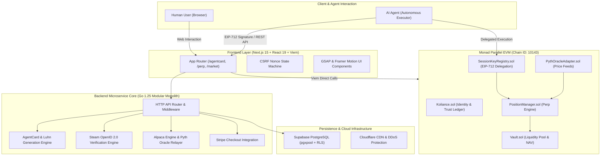

# Koliance

[](https://github.com/moonhotline/koliance/actions/workflows/ci.yml)
[](LICENSE)
[-836EF9.svg)](https://testnet.monad.xyz)
[-363636.svg)](https://soliditylang.org/)
[](https://golang.org)
[](https://nextjs.org)
[](https://react.dev)
[](contracts/coverage)

> **[ English | [简体中文](#简体中文) ]**

---

## Vision

> **Make AI not only able to act, but also worthy of trust.**

In an era of autonomous agents, AI has developed extraordinary execution capabilities but lacks cryptographic identity, economic solvency, and verifiable delegation boundaries. Koliance is an on-chain trust and intelligent finance infrastructure deployed on the **Monad High-Throughput Parallel EVM** (Chain ID: `10143`).

Koliance provides agents with verifiable on-chain identity (DID), bounded economic credit (AgentCard Visa virtual cards), granular cryptographic session key delegation (EIP-712 SessionKeyRegistry), multi-platform reputation proofs (Proof of BUIDL & Play), and a provably solvent perpetual settlement engine (Perp Solvency & Vault). Every agent action is bounded, verifiable, and secure.

---

## Core Pillars

### 1. AgentCard: ISO/IEC 7812 Virtual Cards with EIP-712 Session Delegation
- **Standard Card Generation**: Generates 16-digit Visa virtual cards with BIN `492810`, verified via the **Luhn (MOD 10)** algorithm, complete with CVV and expiration parameters.
- **Granular Session Key Matrix**:
  - `maxPerTxUSD`: Hard ceiling per individual transaction (exceeding amounts trigger Visa decline code 57).
  - `dailyLimitUSD`: Cumulative 24-hour spending limit with rolling window reset.
  - `allowedMCCs`: Merchant Category Code allowlist (e.g. 7999 for gaming, 5814 for dining, 5734 for software services).
  - `expiresAt` & Emergency Circuit Breaker: Granular time-to-live with one-click on-chain revocation and administrative freeze.
- **Micro-Settlement Engine**: Low-latency off-chain balance updates backed by asynchronous batch hashing and on-chain verification on Monad.

### 2. Proof of Identity: Gaming & Developer Reputation Backing
- **Steam Gameplay Proof**: Ingests play history and achievements via verified Steam OpenID 2.0; computes Keccak256 cryptographic proofs committed to `Koliance.sol` to unlock credit allowance.
- **GitHub Proof of BUIDL**: Analyzes public repositories, star counts, and core tech stacks (TypeScript, Go, Solidity) via OAuth 2.0 to mint verifiable on-chain developer credentials.

### 3. Perp DEX: Parallel EVM Solvency & Net NAV Settlement
- **High-Performance Liquidation Engine**: Leverages Monad sub-second block times for up to 50x long/short perpetual positions.
- **Solvency Guards & NAV Pricing**: LP share deposits and redemptions are priced off Net Asset Value (NAV) net of open trader liabilities, mathematically preventing insolvency runs.

---

## System Architecture

Koliance follows a modular monolith and Web3 native architecture:



---

## Tech Stack & Dependency Matrix

### 1. TypeScript & Frontend (`package.json`)
- **Runtime**: Node.js `>=22.13`, Package Manager: **pnpm**
- **Core Framework**: `next: ^15.2.0`, `react: ^19.0.0`, `react-dom: ^19.0.0`
- **Web3 & Database**: `viem: ^2.23.0`, `@supabase/supabase-js: ^2.117.2`
- **Styling & Animation**: `tailwindcss: ^3.4.17`, `gsap: ^3.12.7`, `@gsap/react: ^2.1.2`, `framer-motion: ^12.4.7`, `lucide-react: ^0.475.0`, `canvas-confetti: ^1.9.4`
- **Testing & Tooling**: `typescript: ^5.7.3`, `vitest: ^4.1.11`, `@vitest/coverage-v8: ^4.1.11`, `@playwright/test: ^1.64.0`, `eslint: ^8.57.0`

### 2. Solidity & Smart Contracts (`contracts/`)
- **Solidity Compiler**: `0.8.31` (Target EVM: `osaka`, 200 Optimizer runs)
- **Framework**: `hardhat: ^3.14.0`, `@nomicfoundation/hardhat-ignition: ^3.1.8`, `@nomicfoundation/hardhat-toolbox-viem: ^5.0.7`
- **EVM Libraries**: `viem: ^2.55.19`, `forge-std: github:foundry-rs/forge-std#v1.16.2`, `tsx: ^4.23.15`, `dotenv: ^17.4.2`

### 3. Python AI Agent Toolkit (`requirements.txt`)
- **Runtime**: Python `>=3.11`
- **Web3 & Cryptography**: `web3>=6.15.0`, `eth-account>=0.11.0`, `pycryptodome>=3.20.0`
- **Networking & Schema**: `httpx>=0.27.0`, `requests>=2.31.0`, `pydantic>=2.6.0`, `fastapi>=0.110.0`

### 4. Go Backend Microservice (`backend/go.mod`)
- **Runtime**: Go `1.25.0`
- **Drivers & SDKs**: `github.com/jackc/pgx/v5: v5.11.0`, `github.com/stripe/stripe-go/v78: v78.12.0`, `github.com/joho/godotenv: v1.5.1`

---

## Agent & Contributor Collaboration Standards

Refer to [AGENTS.md](AGENTS.md) for full contributor protocols:

1. **High-Frequency 3% Incremental Commits**: Autonomous agents and developers must deliver continuous, focused increments of ~3% optimization per commit rather than monolithic pull requests.
2. **Zero Plaintext Secrets**: Zero committed keys or credentials. All secrets load dynamically from environment configurations.
3. **Parity & Integer Arithmetic**: Off-chain math must mirror on-chain contracts without truncation drift. All financial calculations use BigInt/integer Wei.
4. **Mandatory Pre-Commit Verification**:
   - Frontend: `pnpm type:lint && pnpm test && pnpm build`
   - Contracts: `cd contracts && npx tsc --noEmit && npx hardhat test --coverage && npx tsx scripts/check-coverage.ts`
   - Backend: `cd backend && go vet ./... && go test -race ./...`

---

## Quick Start

### 1. Installation
```bash
# Frontend and root integration suite
pnpm install --frozen-lockfile

# Smart contracts independent workspace
cd contracts && npm ci && cd ..
```

### 2. Configuration
```bash
cp .env.example .env.local
```

### 3. Local Development
```bash
# Terminal 1: Go backend service (http://localhost:8080)
cd backend && go run cmd/api/main.go

# Terminal 2: Next.js frontend (http://localhost:3000)
pnpm dev
```

---

## Git History & Key Milestones

| Commit / Tag | Description | Scope |
| :--- | :--- | :--- |
| `ffc13f4` | Reconcile stashed changes with latest review hardening; add RLS migrations | Security & Schema |
| `71e09a4` | Merge PR #9: Review hardening, gitleaks secret scanning, pinned Node >=22.13 | CI & Auth |
| `8e7021f` | Price LP shares off NAV net of trader liability (SC-1 Solvency Guard) | Contracts |
| `b36c521` | Drop arbitrary email-domain tier rules; standardize baseline Google auth | Identity & Tier |
| `893138f` | Merge PR #8: Perp solvency verification and live terminal panel | Perp & Frontend |

---

## API Reference

| Method | Endpoint | Description |
| :--- | :--- | :--- |
| `GET` | `/api/v1/health` | Service health status and Monad contract connectivity |
| `GET` | `/api/v1/stats` | Live TPS, active identities, and trust record totals |
| `GET` | `/api/v1/game/steam/profile?id={id}` | Steam player statistics and gameplay rankings |
| `POST` | `/api/v1/game/steam/verify` | Server-side cryptographic Steam OpenID 2.0 verification |
| `POST` | `/api/v1/game/proof` | Generates Keccak256 proof hash for Steam achievements |
| `POST` | `/api/v1/developer/github/proof` | Generates Proof of BUIDL credential for developers |
| `POST` | `/api/v1/agentcard/generate` | Generates Luhn-validated 16-digit Visa virtual card |
| `POST` | `/api/v1/agentcard/session-key` | Issues time-bounded, MCC-restricted Session Key |
| `POST` | `/api/v1/agentcard/authorize` | Real-time micro-transaction authorization |
| `POST` | `/api/v1/agentcard/batch-settle` | Batches settled transactions for on-chain proof |
| `GET` | `/api/v1/market/overview` | Alpaca paper trading balances and positions |
| `GET` | `/api/v1/market/prices?symbol=NVDA` | Real-time stock quote feed |
| `POST` | `/api/v1/market/trade` | Executes leveraged long/short market orders |
| `POST` | `/api/v1/stripe/checkout-session` | Creates Stripe Checkout top-up session |

---

# 简体中文

## 项目远景

> **让 AI 不仅能行动，还值得被信任。**

在自主智能体（Autonomous Agents）爆发的时代，AI 已经具备了惊人的决策与行动能力，但普遍缺乏密码学身份、经济信用与可验证的委托边界。Koliance 构建在 **Monad 高并发并行 EVM**（Chain ID: `10143`）之上，为 AI Agent 提供端到端的**链上数字身份（DID）、自主经济授信（AgentCard Visa 虚拟卡）、细粒度会话密钥委托矩阵（EIP-712 SessionKeyRegistry）、开源与游戏声誉证明（Proof of BUIDL & Play）以及链上可验证的永续合约金融清算内核（Perp Solvency & Vault）**，让每一次 Agent 行动都受控、可验、可信。

---

## 核心业务支柱

### 1. AgentCard 虚拟卡与 EIP-712 权限矩阵
- **标准卡要素生成**：符合国际 ISO/IEC 7812 规范，生成以 492810 为 BIN 码的 16 位卡号，通过 Luhn (MOD 10) 密码学校验。
- **细粒度 Session Key 矩阵**：单笔限额 `maxPerTxUSD`、每日限额 `dailyLimitUSD`、商户类别码 `allowedMCCs` 白名单与即时熔断机制。
- **链下毫秒级清算**：支持高频微支付扣款，通过批次哈希定期归集存证至 Monad。

### 2. 身份与声誉存证 (Proof of Identity)
- **Steam 游戏存证**：基于官方 OpenID 2.0 签名校验，生成游戏时长与成就的 Keccak256 存证证明，兑换信用额度。
- **GitHub 开源背书**：自动聚合公开仓库、Star 与代码技术栈，铸造链上开发者 Proof of BUIDL 凭证。

### 3. 永续合约清算与偿付能力保障 (Perp DEX)
- **并行 EVM 高频撮合**：支持美股与加密标的 1x~50x 多空双向交易。
- **金库偿付能力护栏 (Solvency Guards)**：LP 份额存取款严格以扣除交易负债后的 NAV 净资产值计价，杜绝流动性击穿。

---

## 协同开发准则与 3% 微步迭代

详细准则请参考 [AGENTS.md](AGENTS.md)：
1. **高频提交与 3% 迭代原则**：每次提交仅包含约 3% 的渐进式优化，遵循微步迭代原则，严禁巨型未经拆解的代码合并。
2. **全流程零 Emoji 规范**：代码、控制台日志、注释与文档中严禁包含任何 Emoji 表情符号，采用结构化文本标签 `[INFO]`, `[OK]`, `[WARN]`, `[ERROR]`。
3. **本地 CI 强制门禁**：提交前必须通过前端、合约与 Go 后端的全量测试套件（9 个前端测试套件、202 个合约测试用例、Go 竞态测试全部通过）。

---

## 许可证

本项目采用 [MIT License](LICENSE) 开源许可证。
