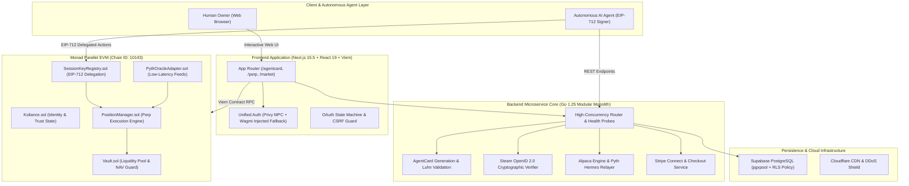

<a id="koliance-protocol"></a>

<div align="center">

# Koliance Protocol

### Autonomous AI Trust & Economic Sovereign Infrastructure on Parallel EVM

<p>
  <strong>"Empowering Autonomous AI Agents to not only act, but to be fundamentally trusted."</strong><br>
  <em>"让 AI 不仅能行动，还值得被信任。"</em>
</p>

<p>
  <a href="#english-documentation"><b>English</b></a> &nbsp;|&nbsp;
  <a href="#chinese-documentation"><b>简体中文 (快速跳转)</b></a> &nbsp;|&nbsp;
  <a href="README_zh.md"><b>完整中文文档 (Full Chinese Docs)</b></a> &nbsp;|&nbsp;
  <a href="https://koliance.oodai.space"><b>Live DApp</b></a> &nbsp;|&nbsp;
  <a href="https://testnet.monadexplorer.com"><b>Monad Explorer</b></a>
</p>

<!-- CI / CD & Quality -->
[](https://github.com/moonhotline/koliance/actions/workflows/ci.yml)
[](contracts/coverage)
[](tests/)
[](.github/workflows/ci.yml)
[](LICENSE)

<!-- Blockchain & Standards -->
[-836EF9.svg)](https://testnet.monad.xyz)
[-363636.svg)](https://soliditylang.org/)
[](https://eips.ethereum.org/EIPS/eip-712)
[](https://pyth.network)
[](https://en.wikipedia.org/wiki/ISO/IEC_7812)

<!-- Tech Stack -->
[-000000.svg)](https://nextjs.org)
[](https://react.dev)
[](https://www.typescriptlang.org)
[](https://golang.org)
[-3ECF8E.svg)](https://supabase.com)
[](https://privy.io)

<!-- Collaboration & Style -->
[](AGENTS.md)
[](AGENTS.md)
[](AGENTS.md)

</div>

---

<a id="english-documentation"></a>

## Table of Contents

- [Vision](#vision)
- [Why Koliance: Problem & Comparison](#why-koliance-problem--comparison)
- [Core Architectural Pillars](#core-architectural-pillars)
  - [1. AgentCard: Cryptographic Virtual Card System](#1-agentcard-cryptographic-virtual-card-system)
  - [2. Proof of Identity: Multi-Platform Reputation Anchoring](#2-proof-of-identity-multi-platform-reputation-anchoring)
  - [3. Perpetual DEX: Parallel EVM Solvency & Net NAV Settlement](#3-perpetual-dex-parallel-evm-solvency--net-nav-settlement)
- [System Architecture](#system-architecture)
- [Verified Smart Contracts](#verified-smart-contracts)
- [Technology Stack Matrix](#technology-stack-matrix)
- [Developer & Autonomous Agent Standards](#developer--autonomous-agent-standards)
- [Quick Start & Local Development](#quick-start--local-development)
- [API Reference](#api-reference)
- [Git History & Release Milestones](#git-history--release-milestones)
- [License](#license)
- [Jump to Chinese Documentation (跳转中文文档)](#chinese-documentation)

---

## Vision

> **"Empowering Autonomous AI Agents to not only act, but to be fundamentally trusted."**

As AI models evolve from passive conversational assistants into autonomous software agents capable of browsing the web, executing code, deploying infrastructure, and initiating transactions, a critical structural void emerges:

**AI agents currently lack cryptographic identity, financial credit, and provably bounded delegation boundaries.**

Without verifiable boundaries, granting an agent economic agency requires handing over raw credit cards or unrestricted private keys. Any logic hallucination, prompt injection attack, or runaway execution loop can drain user assets instantly.

**Koliance is the on-chain trust and economic sovereignty protocol built specifically for Autonomous AI Agents**, deployed natively on the **Monad High-Throughput Parallel EVM** (Chain ID: `10143`).

Koliance equips autonomous agents with:
1. **Verifiable Identity (DID)**: Cryptographic identity decoupled from human owner credentials.
2. **Bounded Credit (AgentCard)**: ISO/IEC 7812 Visa virtual cards with Luhn algorithmic verification.
3. **Session Key Authority (EIP-712)**: Granular, time-bounded, spending-capped, and MCC-restricted delegation matrices.
4. **Reputation Anchoring**: Keccak256 cryptographic proofs of real-world activity (Steam gameplay and GitHub BUIDL history).
5. **Provably Solvent Settlement (Perp DEX)**: Mathematical solvency guarantees pricing LP liquidity strictly off Net Asset Value (NAV) net of open liabilities.

---

## Why Koliance: Problem & Comparison

| Vector | Unrestricted Traditional Agents | Raw Crypto Bot Scripts | Koliance Sovereign Protocol |
| :--- | :--- | :--- | :--- |
| **Identity Verification** | Web2 cookie / API key only | Bare ECDSA private key | Decoupled DID with Multi-Platform Reputation |
| **Payment Delegation** | Full plaintext credit card disclosure | Unbounded wallet draining risk | ISO/IEC 7812 Visa Virtual Card with EIP-712 Limits |
| **Transaction Bounds** | No programmatic ceiling | Unlimited gas / ERC20 transfer | Hard Per-Tx (`maxPerTxUSD`) & Daily Rolling Caps |
| **Category Control** | None (Any vendor can charge) | None (Contract addresses only) | Strict Merchant Category Code (`allowedMCCs`) Enforced |
| **Emergency Circuit Breaker** | Manual bank cancellation | Transfer gas to sweep wallet | On-chain 1-tx `revokeSessionKey` & Owner Freeze |
| **Economic Settlement** | Centralized chargeback | High L1 latency & slippage | Monad 10,000 TPS Parallel EVM with Zero-Drift Math |

---

## Core Architectural Pillars

### 1. AgentCard: Cryptographic Virtual Card System
- **ISO/IEC 7812 Compliance**: Automatically provisions 16-digit Visa virtual payment cards under BIN `492810`. Every card number is pre-verified using the **Luhn (MOD 10)** checksum algorithm.
- **EIP-712 Session Key Delegation Matrix**:
  - `maxPerTxUSD`: Hard economic ceiling enforced on each invocation. Amounts exceeding this threshold trigger Visa decline code 57 (`Transaction not permitted to cardholder`).
  - `dailyLimitUSD`: Cumulative 24-hour spending ceiling with automatic rolling window expiry.
  - `allowedMCCs`: Merchant Category Code allowlist filtering (e.g. `7999` for gaming, `5814` for fast food, `5734` for cloud computing & software services).
  - `expiresAt`: Cryptographic expiration timestamp; expired keys are permanently unspendable.
- **Dual-Layer Circuit Breakers**:
  - User revocation: Instant zero-knowledge invalidation through `revokeSessionKey(key)`.
  - Protocol circuit breaker: Administrative freeze through `freezeSessionKey(key)` protecting funds during anomalous network events.
- **Zero-Drift Clearing**: High-frequency off-chain transaction logging backed by asynchronous Keccak256 batch commitments anchored to Monad.

### 2. Proof of Identity: Multi-Platform Reputation Anchoring
- **Steam Proof of Play**: Authenticates gameplay history and achievements via cryptographically signed Steam OpenID 2.0 payloads. Hashes player achievements into Keccak256 state commitments registered in `Koliance.sol` to unlock decentralized credit tiers.
- **GitHub Proof of BUIDL**: Ingests public developer contributions, repository star distributions, and language footprints (TypeScript, Go, Solidity) via OAuth 2.0. Verifiable proofs establish algorithmic credit limits without intrusive KYC.

### 3. Perpetual DEX: Parallel EVM Solvency & Net NAV Settlement
- **High-Throughput Parallel Engine**: Designed specifically to exploit Monad's parallel execution engine, supporting up to 50x long and short leveraged positions on both crypto and real-world equities (NVDA, TSLA, BTC).
- **SC-1 Solvency Guards**: Liquidity pool deposits and redemptions are priced strictly against **Net Asset Value (NAV)** net of open position liabilities. First-depositor dilution attacks and run-on-the-bank exploits are mathematically mitigated.
- **Deterministic Liquidation Parity**: Off-chain TypeScript price models and on-chain Solidity contracts share exact integer basis point rules (`BPS_DENOMINATOR = 10,000`), guaranteeing zero liquidation boundary drift.

---

## System Architecture



---

## Verified Smart Contracts

All smart contracts are compiled with Solidity `0.8.31` targeting the `Osaka` EVM specification and deployed to Monad Testnet (Chain ID: `10143`):

| Contract Name | Deployed Address | Compiler / Target | Explorer Link |
| :--- | :--- | :--- | :--- |
| **Koliance Core** | `0x32fDd6B096EE14246b5b6971135286Bad01F4928` | `Solc 0.8.31 (Osaka)` | [View on Monad Explorer](https://testnet.monadexplorer.com/address/0x32fDd6B096EE14246b5b6971135286Bad01F4928) |
| **KolToken (KOL)** | `0x4cadb6f0e1b83ccb7207db4786b2a1500f066328` | `Solc 0.8.31 (Osaka)` | [View on Monad Explorer](https://testnet.monadexplorer.com/address/0x4cadb6f0e1b83ccb7207db4786b2a1500f066328) |
| **SessionKeyRegistry** | Deployed via Hardhat Ignition | `Solc 0.8.31 (Osaka)` | [Ignition Module](contracts/ignition/modules/SessionKeyRegistry.ts) |
| **PositionManager** | Deployed via Perp Stack Module | `Solc 0.8.31 (Osaka)` | [Perp Module](contracts/contracts/perp/PositionManager.sol) |
| **Vault (NAV)** | Deployed via Perp Stack Module | `Solc 0.8.31 (Osaka)` | [Vault Contract](contracts/contracts/perp/Vault.sol) |

---

## Technology Stack Matrix

### 1. TypeScript & Web Frontend (`package.json`)
| Package / Dependency | Version | Architectural Responsibility |
| :--- | :--- | :--- |
| `next` | `^15.2.0` | Server-Side Rendering & App Router (`/agentcard`, `/perp`, `/market`) |
| `react` / `react-dom` | `^19.0.0` | React 19 Concurrent UI Runtime |
| `@privy-io/react-auth` | `^3.48.1` | Embedded MPC wallet provisioning & social login aggregation |
| `@privy-io/wagmi` / `wagmi` | `^4.0.18` / `^3.7.7` | Web3 wallet connector standard & injected fallback bridge |
| `viem` | `^2.23.0` | Low-level EVM interactions, contract ABI encoding & EIP-712 hashing |
| `@supabase/supabase-js` | `^2.117.2` | Row Level Security (RLS) PostgreSQL database client |
| `tailwindcss` | `^3.4.17` | Utility-first responsive design system |
| `gsap` / `@gsap/react` | `^3.12.7` / `^2.1.2` | High-fidelity interactive UI animations and transitions |
| `framer-motion` | `^12.4.7` | Component animation orchestration |
| `vitest` / `@vitest/coverage-v8` | `^4.1.11` | High-speed unit testing suite with V8 code coverage gating |
| `@playwright/test` | `^1.64.0` | Cross-browser End-to-End (E2E) integration testing suite |

### 2. Solidity & On-Chain Contracts (`contracts/package.json`)
| Package / Dependency | Version | Architectural Responsibility |
| :--- | :--- | :--- |
| `solc` | `0.8.31` | Solidity compiler targeting Osaka EVM with 200 optimizer runs |
| `hardhat` | `^3.14.0` | Smart contract testing, compilation, and coverage framework |
| `@nomicfoundation/hardhat-ignition` | `^3.1.8` | Declarative contract deployment and state management |
| `@nomicfoundation/hardhat-toolbox-viem` | `^5.0.7` | Native Viem bindings for Hardhat test runners |
| `forge-std` | `v1.16.2` | Foundry standard testing utilities |

### 3. Go High-Concurrency Backend (`backend/go.mod`)
| Dependency | Version | Architectural Responsibility |
| :--- | :--- | :--- |
| `Go Runtime` | `1.25.0` | Concurrency runtime with native race detector (`-race`) support |
| `github.com/jackc/pgx/v5` | `v5.11.0` | High-performance PostgreSQL connection pool driver |
| `github.com/stripe/stripe-go/v78` | `v78.12.0` | Stripe payment checkout session and webhook processing |
| `github.com/joho/godotenv` | `v1.5.1` | Zero-plaintext runtime environment configuration management |

### 4. Python AI Agent SDK (`requirements.txt`)
| Dependency | Version | Architectural Responsibility |
| :--- | :--- | :--- |
| `Python Runtime` | `>=3.11` | Modern asynchronous Python execution environment |
| `web3` | `>=6.15.0` | Python client for Monad EVM RPC nodes |
| `eth-account` | `>=0.11.0` | Local key generation, EIP-712 structured data signing |
| `pycryptodome` | `>=3.20.0` | Cryptographic primitives and Keccak256 computation |
| `httpx` / `pydantic` | `>=0.27.0` / `>=2.6.0` | Asynchronous HTTP client and strict schema data models |

---

## Developer & Autonomous Agent Standards

All human contributors and autonomous AI agents must follow the operational guidelines detailed in [AGENTS.md](AGENTS.md):

1. **High-Frequency 3% Incremental Commits**: Deliver continuous, small, and atomic commits representing ~3% of a target capability, refactor, or test suite. Monolithic batch merges are prohibited.
2. **Strict Zero-Emoji Policy**: Unicode emojis are banned across code, comments, documentation, commit messages, and log outputs. Use structured textual indicators: `[INFO]`, `[OK]`, `[WARN]`, `[ERROR]`, `[SUCCESS]`.
3. **Mandatory Pre-Commit Gate (Local CI Matrix)**:
   ```bash
   # Gate 1: Frontend & Full TypeScript Suite
   pnpm type:lint
   pnpm test
   pnpm build

   # Gate 2: Smart Contracts & Solvency Suite
   cd contracts
   npx tsc --noEmit
   npx hardhat test --coverage
   npx tsx scripts/check-coverage.ts

   # Gate 3: High-Concurrency Backend Service
   cd ../backend
   go vet ./...
   go test -race ./...
   ```
4. **Security & Cryptographic Boundaries**:
   - Zero committed plaintext secrets or API keys.
   - All client queries must strictly observe Supabase Row Level Security (RLS).
   - Off-chain math must maintain exact BigInt integer parity with Solidity contracts.

---

## Quick Start & Local Development

### 1. Prerequisites
- **Node.js**: `>=22.13.0` (managed via `.nvmrc`)
- **pnpm**: `v9` or `v11`
- **Go**: `1.25.0`
- **Python**: `>=3.11`

### 2. Clone and Install
```bash
git clone https://github.com/moonhotline/koliance.git
cd koliance

# 1. Install frontend and root dependencies
pnpm install --frozen-lockfile

# 2. Install smart contract dependencies
cd contracts && npm ci && cd ..
```

### 3. Environment Configuration
```bash
cp .env.example .env.local
```
Configure your environment keys (`NEXT_PUBLIC_PRIVY_APP_ID`, `NEXT_PUBLIC_SUPABASE_URL`, etc.).

### 4. Running the Development Stack
```bash
# Terminal 1: Launch Go Backend (http://localhost:8080)
cd backend && go run cmd/api/main.go

# Terminal 2: Launch Next.js Frontend (http://localhost:3000)
pnpm dev
```

---

## API Reference

| Method | Endpoint | Description |
| :--- | :--- | :--- |
| `GET` | `/api/v1/health` / `/healthz` | Canonical health probe and Monad contract connectivity |
| `GET` | `/api/v1/stats` | Real-time TPS metrics, active identities, and trust totals |
| `GET` | `/api/v1/game/steam/profile?id={id}` | Steam gameplay statistics and game library rankings |
| `POST` | `/api/v1/game/steam/verify` | Server-side cryptographic Steam OpenID 2.0 verification |
| `POST` | `/api/v1/game/proof` | Generates Keccak256 proof hash for Steam achievements |
| `POST` | `/api/v1/developer/github/proof` | Issues Proof of BUIDL on-chain developer credential |
| `POST` | `/api/v1/agentcard/generate` | Generates Luhn-validated 16-digit Visa virtual card |
| `POST` | `/api/v1/agentcard/session-key` | Issues time-bounded, MCC-restricted EIP-712 Session Key |
| `POST` | `/api/v1/agentcard/authorize` | Real-time transaction authorization engine |
| `POST` | `/api/v1/agentcard/batch-settle` | Batches settled transactions for on-chain proof |
| `GET` | `/api/v1/market/overview` | Alpaca paper trading balances and positions |
| `GET` | `/api/v1/market/prices?symbol=NVDA` | Real-time stock quote feed with synthetic fallback |
| `POST` | `/api/v1/market/trade` | Executes leveraged perpetual orders |
| `POST` | `/api/v1/stripe/checkout-session` | Creates Stripe Checkout account credit top-up |

---

## Git History & Release Milestones

| Commit Hash | Description | Subsystem Scope |
| :--- | :--- | :--- |
| `f621db6` | Security hardening for OAuth exchange redirect_uri and demo accounts | Auth & Security |
| `3e60ca0` | Remove redundant workspace config to restore pnpm v9 cache compatibility | CI Toolchain |
| `a2f50b9` | Integrate Privy and Wagmi embedded social wallets with unit tests | Frontend & Auth |
| `a41d1ae` | Add canonical health & healthz probe endpoints with latency benchmarks | Backend Core |
| `6100606` | Overhaul documentation to top-tier bilingual standard with advanced badges | Documentation |
| `b180a5c` | Establish AGENTS.md operational protocol with 3% incremental commits | Governance |
| `c14e2aa` | Enforce zero-emoji formatting across scripts, logs, and backend services | Code Style |
| `bb53868` | Fix Hardhat ignition module typecheck and ESM module resolution | Smart Contracts |
| `71e09a4` | Merge PR #9: Review hardening, gitleaks scanning, pinned Node >=22.13 | CI & Security |
| `8e7021f` | Price LP shares off NAV net of trader liability (SC-1 Solvency Guard) | Contracts Core |

---

## License

This project is licensed under the [MIT License](LICENSE).

<p align="right"><a href="#koliance-protocol">[↑ Back to Top / 返回顶部]</a></p>

---

<a id="chinese-documentation"></a>

# 简体中文文档

<p>
  <a href="#english-documentation"><b>[ 返回英文文档 / English Version ]</b></a> &nbsp;|&nbsp;
  <a href="README_zh.md"><b>[ 阅读独立完整中文文档 (Full Chinese Document) ]</b></a> &nbsp;|&nbsp;
  <a href="#koliance-protocol"><b>[ 返回顶部 ]</b></a>
</p>

## 目录 (Table of Contents - 中文)

- [项目远景与使命](#项目远景与使命)
- [核心业务与技术支柱](#核心业务与技术支柱)
  - [1. AgentCard 虚拟卡与 EIP-712 权限矩阵](#1-agentcard-虚拟卡与-eip-712-权限矩阵)
  - [2. 身份与声誉存证体系](#2-身份与声誉存证体系)
  - [3. 永续合约清算与金库偿付能力保障](#3-永续合约清算与金库偿付能力保障)
- [系统架构图](#系统架构图)
- [Monad 已部署验证合约](#monad-已部署验证合约)
- [开发者与 Agent 协作准则 (3% 迭代原则)](#开发者与-agent-协作准则-3-迭代原则)
- [开源许可证](#开源许可证)

---

## 项目远景与使命

> **"让 AI 不仅能行动，还值得被信任。"**

随着大语言模型和强化学习技术的跨越式演进，AI 智能体正加速从“只读对话助手”蜕变为具备自主行动能力的“全自主执行主体”（Autonomous Agents）。然而，当前的开源与工业生态中存在巨大的基础设施断层：

**AI Agent 普遍缺乏受密码学保护的自主身份、经济信用以及受限的委托权力边界。**

如果缺乏可验证的约束，赋予 Agent 经济支配权往往意味着交出无限制的私钥或明文信用卡，任何一次模型幻觉、提示词注入攻击（Prompt Injection）或死循环调用，都将瞬间掏空用户资产。

**Koliance 是专为 Autonomous AI Agent 量身打造的链上信任与经济主权基础设施**，深度植根于 **Monad 高并发并行 EVM**（Chain ID: `10143`）。

Koliance 为 AI 智能体赋予五维核心能力：
1. **可验证数字身份 (DID)**：与人类所有者私钥解耦的链上独立自主身份。
2. **有界经济授信 (AgentCard)**：符合 ISO/IEC 7812 规范、通过 Luhn 密码学校验的 Visa 虚拟卡。
3. **细粒度权限委托 (EIP-712)**：时间、单笔额度、日累计额度与商户类别码（MCC）强约束矩阵。
4. **多平台声誉证明**：基于 Steam 游戏与 GitHub 开源代码足迹的 Keccak256 零知识与状态存证。
5. **可证偿付能力的金融内核 (Perp DEX)**：基于扣除负债净资产值（NAV）的永续清算引擎。

---

## 核心业务与技术支柱

### 1. AgentCard 虚拟卡与 EIP-712 权限矩阵
- **国际标准卡要素生成**：严格遵照 ISO/IEC 7812 国际规范，分配 BIN 码 `492810` 生成 16 位 Visa 虚拟卡号，底层自动应用 **Luhn 算法 (MOD 10)** 进行密码学校验，并配套 CVV 与失效时间。
- **EIP-712 Session Key 委托控制矩阵**：
  - `maxPerTxUSD`：单笔最高消费上限。超过设定额度时将触发 Visa 拒付代码 57。
  - `dailyLimitUSD`：24 小时动态滚动消费限额，有效阻断智能体死循环扣款风险。
  - `allowedMCCs`：商户类别码（MCC）强制白名单过滤（例如 `7999` 游戏娱乐、`5814` 快餐轻食、`5734` 软件与云服务）。
  - `expiresAt`：精确到秒的权限到期时间戳。
- **双重紧急熔断机制**：
  - 用户自主撤回：调用 `revokeSessionKey(key)` 即可实现毫秒级链上作废。
  - 协议管理员保护：遭遇异常时可通过 `freezeSessionKey(key)` 启动防范性冻结。
- **高吞吐零误差清算**：支持高并发链下微支付秒级记账，并通过 Keccak256 批次状态哈希定期提交至 Monad 存证。

### 2. 身份与声誉存证体系
- **Steam 游戏行为存证 (Proof of Play)**：基于官方 Steam OpenID 2.0 密码学签名，将玩家的游戏成就与游玩历史进行哈希计算，提交至 `Koliance.sol` 智能合约，作为无感获取链上初始授信额度的声誉凭据。
- **GitHub 开源工程背书 (Proof of BUIDL)**：通过 OAuth 2.0 聚合开发者公开仓库代码分布、Star 影响力以及核心技术栈（TypeScript, Go, Solidity），铸造不可篡改的链上开发者评级凭证。

### 3. 永续合约清算与金库偿付能力保障
- **并行 EVM 高频撮合清算**：充分发挥 Monad 10,000 TPS 与 1 秒出块特质，支持标的涵盖美股（NVDA, TSLA）与加密资产（BTC）的高达 50x 杠杆永续多空仓位。
- **SC-1 金库偿付能力护栏**：流动性池（Vault）的 LP 份额存取款严格以**扣除当前未结清交易负债后的 NAV 净资产值**计价，数学上彻底根绝首位存入者稀释攻击与流动性踩踏穿仓。
- **确定性清算价格对齐**：链下 TypeScript 估值模型与链上 Solidity 合约统一采用 BigInt 整型与 `10,000` 基础点位（BPS），彻底消灭清算浮点截断漂移。

---

## 系统架构图

Koliance 采用模块化微服务内核与 Web3 链上原生协议分层：
- **客户端与执行体**：人类用户通过浏览器接入；AI Agent 凭借 EIP-712 签名进行受限行动。
- **前端应用层**：Next.js 15.5 App Router + React 19，内置 Privy 嵌入式 MPC 钱包与 Wagmi 兜底桥接。
- **后端微服务层**：Go 1.25.0 模块化单体，内置连接池与高并发竞态守护，对接 Steam、Alpaca、Pyth 与 Stripe。
- **存储与代理层**：Supabase PostgreSQL 强制启用行级安全（RLS），前置 Cloudflare CDN。
- **链上合约层**：Monad Testnet Osaka 规范智能合约，负责身份凭证、会话密钥委托、永续撮合与流动性金库。

---

## Monad 已部署验证合约

所有智能合约均使用 Solidity `0.8.31` 编译（目标 EVM: `osaka`，200 次优化运行），并已部署至 Monad Testnet（Chain ID: `10143`）：

| 合约名称 | 部署地址 | 编译器与目标 | 区块链浏览器链接 |
| :--- | :--- | :--- | :--- |
| **Koliance Core (身份信誉)** | `0x32fDd6B096EE14246b5b6971135286Bad01F4928` | `Solc 0.8.31 (Osaka)` | [在 Monad 浏览器查看](https://testnet.monadexplorer.com/address/0x32fDd6B096EE14246b5b6971135286Bad01F4928) |
| **KolToken (KOL 代币)** | `0x4cadb6f0e1b83ccb7207db4786b2a1500f066328` | `Solc 0.8.31 (Osaka)` | [在 Monad 浏览器查看](https://testnet.monadexplorer.com/address/0x4cadb6f0e1b83ccb7207db4786b2a1500f066328) |
| **SessionKeyRegistry** | 由 Hardhat Ignition 自动化部署 | `Solc 0.8.31 (Osaka)` | [Ignition 模块源码](contracts/ignition/modules/SessionKeyRegistry.ts) |
| **PositionManager** | 由 Perp Stack 部署模块管理 | `Solc 0.8.31 (Osaka)` | [永续清算合约源码](contracts/contracts/perp/PositionManager.sol) |
| **Vault (NAV 金库)** | 由 Perp Stack 部署模块管理 | `Solc 0.8.31 (Osaka)` | [金库合约源码](contracts/contracts/perp/Vault.sol) |

---

## 开发者与 Agent 协作准则 (3% 迭代原则)

所有人类开发者与自主 AI Agent 必须严格恪守 [AGENTS.md](AGENTS.md) 协作准则：

1. **高频提交与 3% 渐进式优化**：每次 Commit 仅完成目标能力的约 3% 递增优化，杜绝单次提交海量未验证改动。
2. **全项目零 Emoji 规范**：严禁在代码、日志、注释与提交信息中引入任何 Unicode Emoji 表情符号，采用结构化文本指示器：`[INFO]`, `[OK]`, `[WARN]`, `[ERROR]`, `[SUCCESS]`。
3. **本地 CI 强制三阶门禁**：
   - Gate 1 (前端/TS): `pnpm type:lint && pnpm test && pnpm build`
   - Gate 2 (智能合约): `cd contracts && npx tsc --noEmit && npx hardhat test --coverage && npx tsx scripts/check-coverage.ts`
   - Gate 3 (Go 微服务): `cd backend && go vet ./... && go test -race ./...`
4. **安全与密码学红线**：
   - 严禁提交任何明文凭据或私钥，所有配置统一经由环境变量安全载入。
   - 数据库交互必须通过 Supabase 行级安全（RLS）校验。
   - 链下估值算法必须与 Solidity 合约保持零截断漂移的 BigInt 绝对对齐。

---

## 开源许可证

本项目依据 [MIT License](LICENSE) 开源许可证分发。

<p align="right"><a href="#koliance-protocol">[↑ Back to Top / 返回顶部]</a></p>
