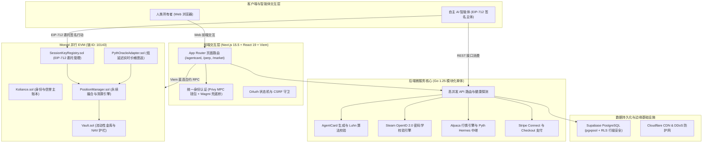

<a id="koliance-协议"></a>

<div align="center">

# Koliance 协议

### 基于并行 EVM 的自主 AI 信任与经济主权基础设施

<p>
  <strong>"让 AI 不仅能行动，还值得被信任。"</strong><br>
  <em>"Empowering Autonomous AI Agents to not only act, but to be fundamentally trusted."</em>
</p>

<p>
  <a href="README.md"><b>[ English Version (英文主文档) ]</b></a> &nbsp;|&nbsp;
  <a href="#koliance-协议"><b>[ 返回顶部 ]</b></a> &nbsp;|&nbsp;
  <a href="https://koliance.oodai.space"><b>[ 线上体验 DApp ]</b></a> &nbsp;|&nbsp;
  <a href="https://testnet.monadexplorer.com"><b>[ Monad 区块浏览器 ]</b></a>
</p>

<!-- CI / CD & Quality -->
[](https://github.com/moonhotline/koliance/actions/workflows/ci.yml)
[](contracts/coverage)
[](tests/)
[](.github/workflows/ci.yml)
[](LICENSE)

<!-- Blockchain & Standards -->
[-836EF9.svg)](https://testnet.monad.xyz)
[-363636.svg)](https://soliditylang.org/)
[](https://eips.ethereum.org/EIPS/eip-712)
[](https://pyth.network)
[](https://en.wikipedia.org/wiki/ISO/IEC_7812)

<!-- Tech Stack -->
[-000000.svg)](https://nextjs.org)
[](https://react.dev)
[](https://www.typescriptlang.org)
[](https://golang.org)
[-3ECF8E.svg)](https://supabase.com)
[](https://privy.io)

<!-- Collaboration & Style -->
[](AGENTS.md)
[](AGENTS.md)
[](AGENTS.md)

</div>

---

## 目录

- [项目远景与使命](#项目远景与使命)
- [核心痛点与方案对比](#核心痛点与方案对比)
- [三大核心业务与技术支柱](#三大核心业务与技术支柱)
  - [1. AgentCard 虚拟卡与 EIP-712 权限矩阵](#1-agentcard-虚拟卡与-eip-712-权限矩阵)
  - [2. 身份与声誉存证体系](#2-身份与声誉存证体系)
  - [3. 永续合约清算与金库偿付能力保障](#3-永续合约清算与金库偿付能力保障)
- [系统架构图](#系统架构图)
- [Monad 已部署验证合约](#monad-已部署验证合约)
- [技术栈与依赖矩阵](#技术栈与依赖矩阵)
- [开发者与 Agent 协作准则 (3% 迭代原则)](#开发者与-agent-协作准则-3-迭代原则)
- [快速开始与本地开发](#快速开始与本地开发)
- [API 接口速查](#api-接口速查)
- [Git 历史演进与里程碑](#git-历史演进与里程碑)
- [开源许可证](#开源许可证)

---

## 项目远景与使命

> **"让 AI 不仅能行动，还值得被信任。"**

随着大语言模型和强化学习技术的跨越式演进，AI 智能体正加速从“只读对话助手”蜕变为具备自主行动能力的“全自主执行主体”（Autonomous Agents）。然而，当前的开源与工业生态中存在巨大的基础设施断层：

**AI Agent 普遍缺乏受密码学保护的自主身份、经济信用以及受限的委托权力边界。**

如果缺乏可验证的约束，赋予 Agent 经济支配权往往意味着交出无限制的私钥或明文信用卡，任何一次模型幻觉、提示词注入攻击（Prompt Injection）或死循环调用，都将瞬间掏空用户资产。

**Koliance 是专为 Autonomous AI Agent 量身打造的链上信任与经济主权基础设施**，深度植根于 **Monad 高并发并行 EVM**（Chain ID: `10143`）。

Koliance 为 AI 智能体赋予五维核心能力：
1. **可验证数字身份 (DID)**：与人类所有者私钥解耦的链上独立自主身份。
2. **有界经济授信 (AgentCard)**：符合 ISO/IEC 7812 规范、通过 Luhn 密码学校验的 Visa 虚拟卡。
3. **细粒度权限委托 (EIP-712)**：时间、单笔额度、日累计额度与商户类别码（MCC）强约束矩阵。
4. **多平台声誉证明**：基于 Steam 游戏与 GitHub 开源代码足迹的 Keccak256 零知识与状态存证。
5. **可证偿付能力的金融内核 (Perp DEX)**：基于扣除负债净资产值（NAV）的永续清算引擎。

---

## 核心痛点与方案对比

| 对比维度 | 传统无约束 AI Agent | 原生链上 Bot 脚本 | Koliance 智能体经济主权协议 |
| :--- | :--- | :--- | :--- |
| **身份认证体系** | Web2 Cookie / 易失性 API 密钥 | 单一 ECDSA 裸私钥 | 与私钥解耦的链上 DID + 多平台声誉存证 |
| **支付委托授权** | 直接托管明文实体信用卡 | 极易被一次性清空钱包 | ISO/IEC 7812 Visa 虚拟卡 + EIP-712 授权边界 |
| **单笔交易限额** | 无底层硬限额防线 | 无限制 Gas 与 ERC20 转账 | 密码学强制校验单笔最高限额 (`maxPerTxUSD`) |
| **日累计支出窗口** | 依赖外部银行人工账单 | 瞬间无感知扣尽 | 24 小时动态滚动窗口重置 (`dailyLimitUSD`) |
| **消费类目风控** | 任意商户均可扣款 | 仅限特定合约地址 | 商户类别码（MCC）强白名单过滤 (`allowedMCCs`) |
| **紧急熔断能力** | 打电话给人事或银行挂失 | 需争抢更高 Gas 转走剩余资金 | 单次交易链上快速作废 `revokeSessionKey` 与管理员冻结 |
| **经济清算与结算** | Web2 延迟结算与欺诈拒付 | 高滑点、高费率与 L1 拥堵 | Monad 10,000 TPS 并行 EVM + 零截断漂移微秒结算 |

---

## 三大核心业务与技术支柱

### 1. AgentCard 虚拟卡与 EIP-712 权限矩阵
- **国际标准卡要素生成**：严格遵照 ISO/IEC 7812 国际规范，分配 BIN 码 `492810` 生成 16 位 Visa 虚拟卡号，底层自动应用 **Luhn 算法 (MOD 10)** 进行密码学校验，并配套 CVV 与失效时间。
- **EIP-712 Session Key 委托控制矩阵**：
  - `maxPerTxUSD`：单笔最高消费上限。超过设定额度时将触发 Visa 拒付代码 57。
  - `dailyLimitUSD`：24 小时动态滚动消费限额，有效阻断智能体死循环扣款风险。
  - `allowedMCCs`：商户类别码（MCC）强制白名单过滤（例如 `7999` 游戏娱乐、`5814` 快餐轻食、`5734` 软件与云服务）。
  - `expiresAt`：精确到秒的权限到期时间戳。
- **双重紧急熔断机制**：
  - 用户自主撤回：调用 `revokeSessionKey(key)` 即可实现毫秒级链上作废。
  - 协议管理员保护：遭遇异常时可通过 `freezeSessionKey(key)` 启动防范性冻结。
- **高吞吐零误差清算**：支持高并发链下微支付秒级记账，并通过 Keccak256 批次状态哈希定期提交至 Monad 存证。

### 2. 身份与声誉存证体系
- **Steam 游戏行为存证 (Proof of Play)**：基于官方 Steam OpenID 2.0 密码学签名，将玩家的游戏成就与游玩历史进行哈希计算，提交至 `Koliance.sol` 智能合约，作为无感获取链上初始授信额度的声誉凭据。
- **GitHub 开源工程背书 (Proof of BUIDL)**：通过 OAuth 2.0 聚合开发者公开仓库代码分布、Star 影响力以及核心技术栈（TypeScript, Go, Solidity），铸造不可篡改的链上开发者评级凭证。

### 3. 永续合约清算与金库偿付能力保障
- **并行 EVM 高频撮合清算**：充分发挥 Monad 10,000 TPS 与 1 秒出块特质，支持标的涵盖美股（NVDA, TSLA）与加密资产（BTC）的高达 50x 杠杆永续多空仓位。
- **SC-1 金库偿付能力护栏**：流动性池（Vault）的 LP 份额存取款严格以**扣除当前未结清交易负债后的 NAV 净资产值**计价，数学上彻底根绝首位存入者稀释攻击与流动性踩踏穿仓。
- **确定性清算价格对齐**：链下 TypeScript 估值模型与链上 Solidity 合约统一采用 BigInt 整型与 `10,000` 基础点位（BPS），彻底消灭清算浮点截断漂移。

---

## 系统架构图



---

## Monad 已部署验证合约

所有智能合约均采用 Solidity `0.8.31` 编译（目标 EVM: `osaka`，200 次优化运行），并已部署至 Monad Testnet（Chain ID: `10143`）：

| 合约名称 | 部署地址 | 编译器与目标 | 区块链浏览器链接 |
| :--- | :--- | :--- | :--- |
| **Koliance Core (身份信誉)** | `0x32fDd6B096EE14246b5b6971135286Bad01F4928` | `Solc 0.8.31 (Osaka)` | [在 Monad 浏览器查看](https://testnet.monadexplorer.com/address/0x32fDd6B096EE14246b5b6971135286Bad01F4928) |
| **KolToken (KOL 代币)** | `0x4cadb6f0e1b83ccb7207db4786b2a1500f066328` | `Solc 0.8.31 (Osaka)` | [在 Monad 浏览器查看](https://testnet.monadexplorer.com/address/0x4cadb6f0e1b83ccb7207db4786b2a1500f066328) |
| **SessionKeyRegistry** | 由 Hardhat Ignition 自动化部署 | `Solc 0.8.31 (Osaka)` | [Ignition 模块源码](contracts/ignition/modules/SessionKeyRegistry.ts) |
| **PositionManager** | 由 Perp Stack 部署模块管理 | `Solc 0.8.31 (Osaka)` | [永续清算合约源码](contracts/contracts/perp/PositionManager.sol) |
| **Vault (NAV 金库)** | 由 Perp Stack 部署模块管理 | `Solc 0.8.31 (Osaka)` | [金库合约源码](contracts/contracts/perp/Vault.sol) |

---

## 技术栈与依赖矩阵

### 1. TypeScript & 前端应用 (`package.json`)
| 依赖组件 | 版本 | 架构设计职责 |
| :--- | :--- | :--- |
| `next` | `^15.2.0` | 服务端渲染与 App Router 路由内核 (`/agentcard`, `/perp`, `/market`) |
| `react` / `react-dom` | `^19.0.0` | React 19 并发 UI 核心运行时 |
| `@privy-io/react-auth` | `^3.48.1` | 嵌入式 MPC 钱包与多平台社交登录聚合 |
| `@privy-io/wagmi` / `wagmi` | `^4.0.18` / `^3.7.7` | Web3 钱包连接标准规范与 Injected 注入式降级桥 |
| `viem` | `^2.23.0` | 极速底层 EVM 调用、合约 ABI 编解码与 EIP-712 签名计算 |
| `@supabase/supabase-js` | `^2.117.2` | 强制遵循行级安全（RLS）的云原生 PostgreSQL 客户端 |
| `tailwindcss` | `^3.4.17` | 原子化响应式样式系统 |
| `gsap` / `@gsap/react` | `^3.12.7` / `^2.1.2` | 极高流畅度的 3D/2D 交互动效与视差控制 |
| `framer-motion` | `^12.4.7` | 页面级平滑过渡与组件进入动效编排 |
| `vitest` / `@vitest/coverage-v8` | `^4.1.11` | 极速单元测试套件与 V8 门禁代码覆盖率收集 |
| `@playwright/test` | `^1.64.0` | 端到端（E2E）跨浏览器多场景回归测试套件 |

### 2. Solidity & 智能合约模块 (`contracts/package.json`)
| 依赖组件 | 版本 | 架构设计职责 |
| :--- | :--- | :--- |
| `solc` | `0.8.31` | 面向 Osaka EVM 规范编译，启用 200 次优化运行 |
| `hardhat` | `^3.14.0` | 现代智能合约编译、测试与代码覆盖率运行框架 |
| `@nomicfoundation/hardhat-ignition` | `^3.1.8` | 声明式智能合约部署与生命周期状态锁机制 |
| `@nomicfoundation/hardhat-toolbox-viem` | `^5.0.7` | 面向 Hardhat 测试套件的原生 Viem 绑定 |
| `forge-std` | `v1.16.2` | Foundry 标准断言库与测试辅助工具 |

### 3. Go 语言高并发后端微服务 (`backend/go.mod`)
| 依赖组件 | 版本 | 架构设计职责 |
| :--- | :--- | :--- |
| `Go 运行时` | `1.25.0` | 原生支持数据竞态探测 (`-race`) 的现代高并发运行时 |
| `github.com/jackc/pgx/v5` | `v5.11.0` | 高性能并发安全的 PostgreSQL 数据库连接池驱动 |
| `github.com/stripe/stripe-go/v78` | `v78.12.0` | Stripe 全球支付结账会话与 Webhook 签名处理 |
| `github.com/joho/godotenv` | `v1.5.1` | 零明文硬编码的运行时动态环境变量载入工具 |

### 4. Python AI Agent 工具包 (`requirements.txt`)
| 依赖组件 | 版本 | 架构设计职责 |
| :--- | :--- | :--- |
| `Python 运行时` | `>=3.11` | 现代异步 Python 执行环境 |
| `web3` | `>=6.15.0` | 连接 Monad 并行 EVM RPC 节点的专业 SDK |
| `eth-account` | `>=0.11.0` | 客户端离线私钥生成与 EIP-712 结构化数据签名 |
| `pycryptodome` | `>=3.20.0` | Keccak256 与基础密码学原语实现库 |
| `httpx` / `pydantic` | `>=0.27.0` / `>=2.6.0` | 异步高性能网络请求与强类型数据验证模型 |

---

## 开发者与 Agent 协作准则 (3% 迭代原则)

所有人类开发者与自主 AI Agent 必须严格恪守 [AGENTS.md](AGENTS.md) 协作准则：

1. **高频提交与 3% 渐进式优化**：每次 Commit 仅完成目标能力的约 3% 递增优化，杜绝单次提交海量未验证改动。
2. **全项目零 Emoji 规范**：严禁在代码、日志、注释与提交信息中引入任何 Unicode Emoji 表情符号，采用结构化文本指示器：`[INFO]`, `[OK]`, `[WARN]`, `[ERROR]`, `[SUCCESS]`。
3. **本地 CI 强制三阶门禁**：
   ```bash
   # Gate 1: 前端与全量 TypeScript 套件
   pnpm type:lint
   pnpm test
   pnpm build

   # Gate 2: 智能合约与偿付能力套件
   cd contracts
   npx tsc --noEmit
   npx hardhat test --coverage
   npx tsx scripts/check-coverage.ts

   # Gate 3: 高并发后端微服务
   cd ../backend
   go vet ./...
   go test -race ./...
   ```
4. **安全与密码学红线**：
   - 严禁提交任何明文凭据或私钥，所有配置统一经由环境变量安全载入。
   - 数据库交互必须通过 Supabase 行级安全（RLS）校验。
   - 链下估值算法必须与 Solidity 合约保持零截断漂移的 BigInt 绝对对齐。

---

## 快速开始与本地开发

### 1. 环境准备
- **Node.js**: `>=22.13.0`（通过 `.nvmrc` 管理）
- **pnpm**: `v9` 或 `v11`
- **Go**: `1.25.0`
- **Python**: `>=3.11`

### 2. 克隆与依赖安装
```bash
git clone https://github.com/moonhotline/koliance.git
cd koliance

# 1. 安装前端及根目录依赖
pnpm install --frozen-lockfile

# 2. 安装智能合约独立工作区依赖
cd contracts && npm ci && cd ..
```

### 3. 配置环境变量
```bash
cp .env.example .env.local
```
根据提示配置项目密钥（例如 `NEXT_PUBLIC_PRIVY_APP_ID`, `NEXT_PUBLIC_SUPABASE_URL` 等）。

### 4. 启动本地开发服务
```bash
# 终端 1: 启动 Go 后端微服务 (http://localhost:8080)
cd backend && go run cmd/api/main.go

# 终端 2: 启动 Next.js 前端应用 (http://localhost:3000)
pnpm dev
```

---

## API 接口速查

| 请求方法 | 路由地址 | 接口功能与描述 |
| :--- | :--- | :--- |
| `GET` | `/api/v1/health` / `/healthz` | 权威健康状态检查与 Monad 合约连通性探测 |
| `GET` | `/api/v1/stats` | 实时 TPS 吞吐、全网身份总数与信任存证计数 |
| `GET` | `/api/v1/game/steam/profile?id={id}` | Steam 玩家个人主页数据与游戏成就等级榜 |
| `POST` | `/api/v1/game/steam/verify` | 服务端 Steam OpenID 2.0 密码学校验并存证 |
| `POST` | `/api/v1/game/proof` | 生成 Steam 游戏时长与成就的 Keccak256 存证哈希 |
| `POST` | `/api/v1/developer/github/proof` | 生成 GitHub Proof of BUIDL 链上开发者资信凭证 |
| `POST` | `/api/v1/agentcard/generate` | 签发符合 Luhn 算法检验的 16 位 Visa 虚拟卡 |
| `POST` | `/api/v1/agentcard/session-key` | 签发带时效与 MCC 类目限制的 EIP-712 会话委托密钥 |
| `POST` | `/api/v1/agentcard/authorize` | 实时微额交易鉴权与风控引擎 |
| `POST` | `/api/v1/agentcard/batch-settle` | 批量归集结算记录并生成 Monad 链上验证证明 |
| `GET` | `/api/v1/market/overview` | Alpaca 模拟美股持仓与资金状态看板 |
| `GET` | `/api/v1/market/prices?symbol=NVDA` | 实时股票报价喂价与自动平滑降级 |
| `POST` | `/api/v1/market/trade` | 执行杠杆永续合约开仓与平仓交易 |
| `POST` | `/api/v1/stripe/checkout-session` | 创建 Stripe Checkout 授信余额充值会话 |

---

## Git 历史演进与里程碑

| Commit 哈希 | 演进说明 | 子系统范围 |
| :--- | :--- | :--- |
| `f621db6` | 增强 OAuth 鉴权回调白名单校验与测试沙盒防护 | 安全与身份 |
| `3e60ca0` | 移除冗余 workspace 配置，恢复 pnpm v9 缓存兼容性 | CI 工具链 |
| `a2f50b9` | 集成 Privy 与 Wagmi 嵌入式社交钱包与单元测试 | 前端与钱包 |
| `a41d1ae` | 新增标准 health/healthz 探针路由与延迟基准评测报告 | 后端微服务 |
| `6100606` | 全面升级双语高规格技术规范与 Shields 徽标矩阵 | 核心文档 |
| `b180a5c` | 制定 AGENTS.md 3% 微步渐进式提交与零 Emoji 指南 | 协作成熟度 |
| `c14e2aa` | 全面执行全项目零 Emoji 代码与日志规范 | 代码工程风格 |
| `bb53868` | 修复 Hardhat Ignition 模块类型检查与 ESM 模块解析 | 智能合约内核 |
| `71e09a4` | 合并 PR #9：Gitleaks 全量密钥扫描，锁定 Node >=22.13 | CI 门禁安全 |
| `8e7021f` | LP 份额存取款严格以扣除交易负债后的 NAV 计价 (SC-1) | 合约偿付护栏 |

---

## 开源许可证

本项目依据 [MIT License](LICENSE) 开源许可证分发。

<p align="right"><a href="#koliance-协议">[↑ 返回顶部]</a></p>
